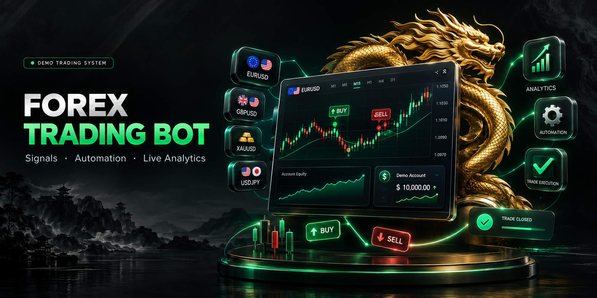

<p align="center">
  
</p>

<div align="center">

# Forex Trading Bot

**A full-stack Forex signal engine and simulated trading dashboard powered by live OANDA market data.**

Signals · Risk management · Live analytics · Trade journal · Account simulation

<br />

[](https://nodejs.org/)
[](https://www.typescriptlang.org/)
[](https://react.dev/)
[](https://vite.dev/)
[](https://expressjs.com/)
[](https://tailwindcss.com/)

[](https://developer.oanda.com/)
[](#risk-model)
[](#risk-model)
[](#important-limitations)

<br />


</div>

---

## Overview

**Forex Trading Bot** is a self-hosted Forex dashboard that turns live OANDA price data into actionable, risk-defined trade ideas. It scans 14 FX, metal, energy, and crypto instruments, detects high-volume untested supply and demand zones, confirms entries with M1 reversal volume, and tracks each idea through take profit, stop loss, ambiguity, or expiry.

The app combines a real-time signal engine with a polished React interface, a simulated account, a trade journal, and balance controls. It is designed as an educational and research platform for building disciplined, risk-first trading workflows.

> **This is a demo trading system.** Signals and trades are simulated. The project does not place live orders.

---

## Why This Project

Most signal dashboards stop at a marker on a chart. This project focuses on the full workflow:

- **Risk-defined signals** — every trade risks exactly **3% of the current account balance**.
- **Fixed 2R targets** — take profit is always **2x the stop distance**.
- **Live market context** — current price, entry, stop, target, R multiple, and progress.
- **A visual trade state** — each open signal includes a compact SL-vs-TP tug-of-war scene with the live market marker and entry point.
- **A simulated account** — realized PnL, floating PnL, equity, deposits, and trade history.
- **Operational safety** — same-origin mutation checks, rate limiting, JSON body limits, and hardened response headers.

---

## Features

### Signal engine

- 14 instruments: `XAUUSD`, `EURUSD`, `GBPUSD`, `AUDUSD`, `NZDUSD`, `USDJPY`, `EURJPY`, `GBPJPY`, `USDCHF`, `GBPCHF`, `AUDCHF`, `AUDCAD`, `BTCUSD`, and `XTIUSD`.
- H1 and M30 body-zone detection using high-volume candles.
- M1 reversal confirmation with relative volume expansion.
- Live S5 price refresh for open positions.
- One open position per symbol by default.
- 60-minute same-symbol re-entry cooldown.
- Automatic TP, SL, ambiguous-candle, and 24-hour expiry resolution.
- Duplicate signal protection and historical outcome tracking.

### Risk model

- **Risk per trade:** 3% of the current simulated account balance.
- **Reward target:** 6% of the balance at entry, before fees and slippage.
- **Risk-to-reward ratio:** exactly **1:2**.
- SL and TP distances are calculated per instrument using contract size and USD quote conversion.
- Lot size controls the price distance required to reach the 3% risk amount.
- Open positions are re-targeted to the active risk model when the engine starts.

### Dashboard

- Live Signals and Trades pages.
- Mobile-first responsive layout.
- Open, TP, SL, ambiguous, and expired signal filters.
- Per-signal mini tug-of-war visualization with an SL/TP scale, live market marker, and entry tick.
- Market watch strip with current prices and 24-hour context.
- Account summary with balance, equity, realized PnL, floating PnL, and open trade count.
- Trade history with entry, stop, target, exit, lot size, and outcome.
- Balance deposits and lot-size controls.

### Engineering

- Shared TypeScript types between server and client.
- Persistent local state file for signals, trades, and account balance.
- Express API with Vite middleware in development.
- Security headers and mutation protection.
- Reduced-motion support for dashboard animations.
- Production build through Vite.

---

## Tech Stack

| Layer | Technology |
| --- | --- |
| Runtime | Node.js |
| Language | TypeScript |
| Frontend | React 19 |
| Build tool | Vite 8 |
| Styling | Tailwind CSS 4 |
| Backend | Express 4 |
| Market data | OANDA v20 REST API |
| Icons | Lucide React |
| Persistence | JSON state file |

<p align="center">
  
</p>

---

## How It Works

```text
OANDA S5 prices
      │
      ▼
H1 / M30 untested high-volume body zones
      │
      ▼
M1 reversal candle + volume confirmation
      │
      ▼
Duplicate and cooldown checks
      │
      ▼
3% balance risk + 2R target calculation
      │
      ▼
Simulated trade opened
      │
      ▼
TP / SL / ambiguous / expiry watcher
      │
      ▼
Trade history, account balance, and dashboard update
```

### 1. Market data

The server refreshes S5 candles for the configured symbols and keeps the latest price in memory. Open signals receive live prices without waiting for the next scan.

### 2. Zone discovery

H1 and M30 candles are analyzed for high-volume body zones. A zone is considered untested when price has not revisited its body. Distance, volume ratio, direction, and timeframe are retained for the dashboard.

### 3. Entry confirmation

The engine looks for a reversal candle touching an untested zone. Long setups require a green M1 candle at demand; short setups require a red M1 candle at supply. Relative volume must exceed the confirmation threshold.

### 4. Risk and target calculation

When a signal is accepted:

```text
riskUsd   = account balance × 3%
rewardUsd = riskUsd × 2
```

The engine converts those USD amounts into instrument-specific price distances using the configured lot size, contract units, and quote conversion. Stop loss and take profit are then placed symmetrically around the entry, with TP at twice the stop distance.

### 5. Trade lifecycle

The engine tracks each open signal against live candles. A trade closes when:

- take profit is reached,
- stop loss is reached,
- an ambiguous candle touches both levels,
- the maximum tracking window expires.

Closed trades update the simulated balance and are written to the local state file.

### 6. Dashboard updates

The React client polls the signal API, renders live cards, and keeps the market strip, account summary, and trade journal in sync.

---

## Quick Start

### Requirements

- Node.js 20 or newer
- npm
- An OANDA v20 API token

### 1. Clone the repository

```bash
git clone https://github.com/Dzuhaib/AI-Forex-Trading-Bot.git
cd AI-Forex-Trading-Bot
```

### 2. Install dependencies

```bash
npm install --legacy-peer-deps
```

### 3. Configure environment variables

```bash
cp .env.example .env
```

Open `.env` and add your OANDA credentials:

```env
OANDA_API_KEY=your_oanda_v20_token
OANDA_ENVIRONMENT=practice
SIGNAL_REENTRY_COOLDOWN_MIN=60
```

Use `practice` while developing. Switch to `live` only when you understand the risks and have verified your OANDA account configuration.

### 4. Start the app

```bash
npm run dev
```

Open [http://localhost:3000](http://localhost:3000).

The first scan can take a moment while the engine loads candles. The dashboard will populate as market data arrives.

---

## Environment Variables

| Variable | Default | Purpose |
| --- | --- | --- |
| `OANDA_API_KEY` | required | OANDA v20 API token. Never commit this value. |
| `OANDA_ENVIRONMENT` | `practice` | `practice` or `live`. |
| `SIGNAL_ENGINE_ENABLED` | `true` | Enable or disable signal generation. |
| `SIGNAL_SCAN_INTERVAL_MS` | `25000` | Zone scan interval. |
| `SIGNAL_WATCH_INTERVAL_MS` | `5000` | Open-trade watcher interval. |
| `SIGNAL_PRICE_INTERVAL_MS` | `500` | S5 live-price refresh interval. |
| `SIGNAL_MAX_TRACK_HOURS` | `24` | Maximum lifetime for an open signal. |
| `SIGNAL_MAX_OPEN_PER_SYMBOL` | `1` | Maximum simultaneous open signals per symbol. |
| `SIGNAL_REENTRY_COOLDOWN_MIN` | `60` | Same-symbol re-entry cooldown in minutes. |
| `SIGNAL_LEVERAGE` | `10` | Leverage value shown in return-on-equity calculations. |
| `SIGNAL_SCAN_CONCURRENCY` | `10` | Parallel symbol scans. |
| `SIGNAL_WATCH_CONCURRENCY` | `6` | Parallel trade watchers. |
| `SIGNAL_PAIRS` | all 14 | Comma-separated symbol allowlist. |
| `SIGNAL_STATE_FILE` | `data/live_signals_state.json` | Local persistence path. |

---

## Scripts

| Command | Description |
| --- | --- |
| `npm run dev` | Start the Express server with Vite middleware. |
| `npm run start` | Start the server using the `start` script. |
| `npm run lint` | Type-check the project with `tsc --noEmit`. |
| `npm run build` | Create the production client bundle in `dist/`. |

---

## Project Structure

```text
.
├── assets/
│   └── banner.png
├── data/
│   └── live_signals_state.json   # local runtime state (gitignored)
├── src/
│   ├── components/
│   │   ├── DummyTradesViewer.tsx
│   │   ├── LiveSignalsViewer.tsx
│   │   ├── MiniTugOfWar.tsx
│   │   └── ...
│   ├── App.tsx
│   ├── index.css
│   ├── main.tsx
│   └── types.ts
├── .env.example
├── .gitignore
├── index.html
├── package.json
├── server.ts
├── signalEngine.ts
└── README.md
```

---

## API Reference

| Method | Endpoint | Description |
| --- | --- | --- |
| `GET` | `/api/signals` | Full dashboard payload: signals, market, account, and trades. |
| `POST` | `/api/signals/scan` | Trigger an immediate scan. |
| `POST` | `/api/account/add-balance` | Add simulated balance. |
| `POST` | `/api/account/lot-size` | Update the strategy lot size. |

All state-changing routes are same-origin guarded and rate-limited to 30 requests per minute per client.

---

## Risk Model

The engine is intentionally explicit about risk:

- **Account risk:** 3% of the current simulated balance at signal creation.
- **Target:** 2R, equal to 6% of the balance at entry.
- **Stop distance:** derived from the risk amount and selected lot size.
- **Take-profit distance:** exactly twice the stop distance.
- **Balance model:** the simulated balance excludes floating PnL; equity includes it.

The lot-size control changes the price distance used to express the same 3% risk. A larger lot produces a tighter stop; a smaller lot produces a wider stop. This keeps the monetary risk defined by the account balance rather than by a fixed dollar target.

---

## Security Notes

- `.env` and runtime state are gitignored.
- Mutation routes reject cross-origin requests.
- Same-origin `Sec-Fetch-Site` checks are enforced when present.
- Mutation requests are rate-limited.
- JSON bodies are capped at 16 KB.
- Security headers include `X-Content-Type-Options`, `X-Frame-Options`, `Referrer-Policy`, `Permissions-Policy`, and `Cross-Origin-Resource-Policy`.
- The Express fingerprint header is disabled.
- JSON responses are escaped.

Never expose your OANDA API token in the browser, screenshots, issues, or commits.

---

## Important Limitations

- This project is **not** a live trading system. It does not submit OANDA orders.
- The account and deposits are simulated.
- The local JSON state file is suitable for a single-instance demo, not a horizontally scaled production deployment.
- The included Express + Vite setup expects a persistent Node.js process.
- Market data availability and rate limits depend on your OANDA account.
- Nothing in this repository is financial advice.

---

## Author

**Dzuhaib**

Builder of risk-first trading dashboards and full-stack market tooling. This project explores how live market data, deterministic volume analysis, disciplined risk sizing, and a clean interface can work together in one self-hosted system.

- GitHub: [@Dzuhaib](https://github.com/Dzuhaib)
- Repository: [AI-Forex-Trading-Bot](https://github.com/Dzuhaib/AI-Forex-Trading-Bot)

---

## Disclaimer

Trading Forex, metals, energy, and crypto involves substantial risk. This software is provided for educational and research purposes only. Past simulated performance does not guarantee future results. Always test with a practice account and never risk capital you cannot afford to lose.

<p align="center">
  <sub>Built with Node.js, TypeScript, React, and OANDA market data.</sub>
</p>
